# itsrealkaran

The year is a grid. Under it: the last year, the longest streak, the current streak, and stars.

## classic

**contributions** · classic · mini

`https://github.com/itsrealkaran/contributions?username=itsrealkaran&theme=classic&size=mini`

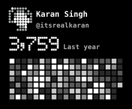

**contributions** · classic · compact

`https://github.com/itsrealkaran/contributions?username=itsrealkaran&theme=classic&size=compact`

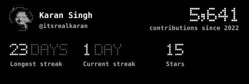

**contributions** · classic · regular

`https://github.com/itsrealkaran/contributions?username=itsrealkaran&theme=classic&size=regular`

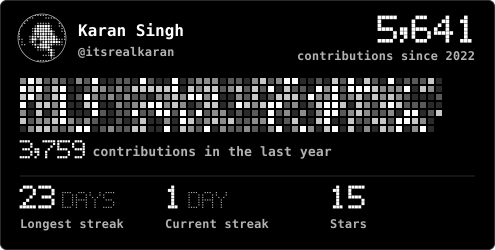

**contributions** · classic · wide

`https://github.com/itsrealkaran/contributions?username=itsrealkaran&theme=classic&size=wide`

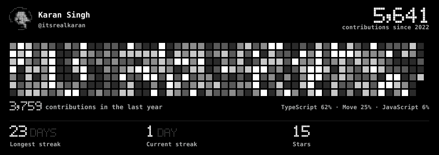

## classic-r

**contributions** · classic-r · mini

`https://github.com/itsrealkaran/contributions?username=itsrealkaran&theme=classic-r&size=mini`

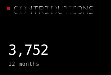

**contributions** · classic-r · compact

`https://github.com/itsrealkaran/contributions?username=itsrealkaran&theme=classic-r&size=compact`

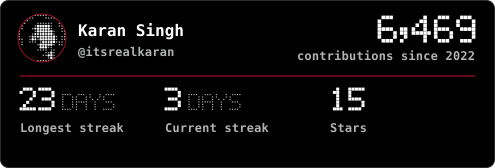

**contributions** · classic-r · regular

`https://github.com/itsrealkaran/contributions?username=itsrealkaran&theme=classic-r&size=regular`

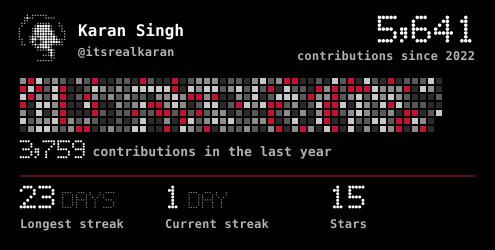

**contributions** · classic-r · wide

`https://github.com/itsrealkaran/contributions?username=itsrealkaran&theme=classic-r&size=wide`

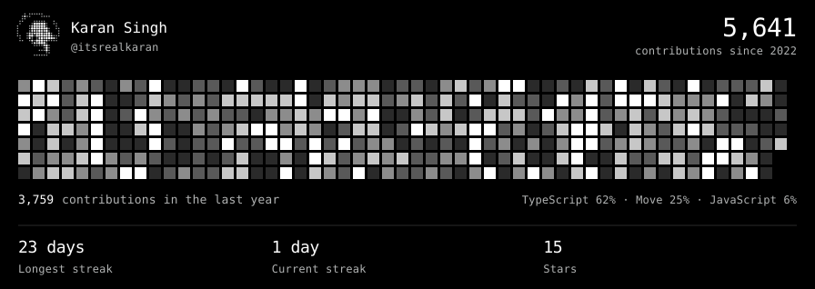

## white

**contributions** · white · mini

`https://github.com/itsrealkaran/contributions?username=itsrealkaran&theme=white&size=mini`

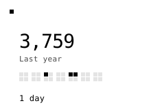

**contributions** · white · compact

`https://github.com/itsrealkaran/contributions?username=itsrealkaran&theme=white&size=compact`

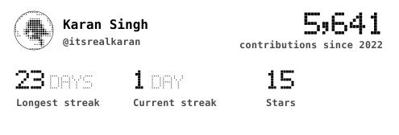

**contributions** · white · regular

`https://github.com/itsrealkaran/contributions?username=itsrealkaran&theme=white&size=regular`

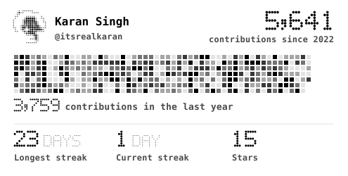

**contributions** · white · wide

`https://github.com/itsrealkaran/contributions?username=itsrealkaran&theme=white&size=wide`

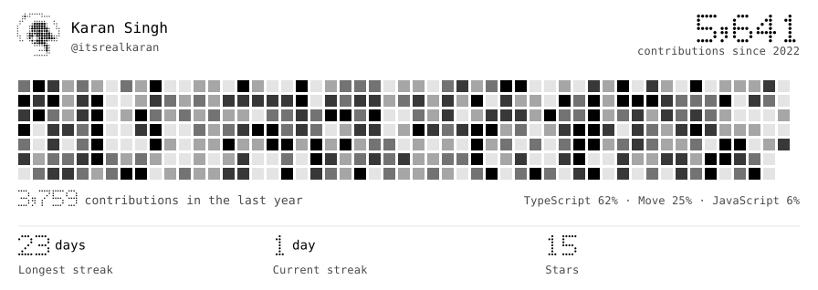

## white-r

**contributions** · white-r · mini

`https://github.com/itsrealkaran/contributions?username=itsrealkaran&theme=white-r&size=mini`

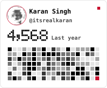

**contributions** · white-r · compact

`https://github.com/itsrealkaran/contributions?username=itsrealkaran&theme=white-r&size=compact`

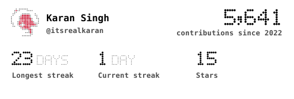

**contributions** · white-r · regular

`https://github.com/itsrealkaran/contributions?username=itsrealkaran&theme=white-r&size=regular`

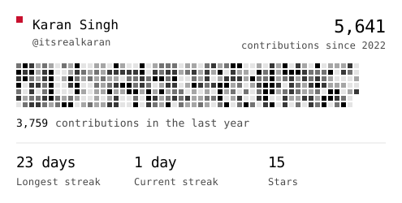

**contributions** · white-r · wide

`https://github.com/itsrealkaran/contributions?username=itsrealkaran&theme=white-r&size=wide`

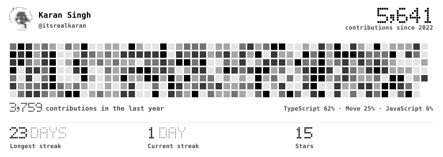

## light

**contributions** · light · mini

`https://github.com/itsrealkaran/contributions?username=itsrealkaran&theme=light&size=mini`

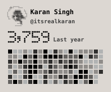

**contributions** · light · compact

`https://github.com/itsrealkaran/contributions?username=itsrealkaran&theme=light&size=compact`

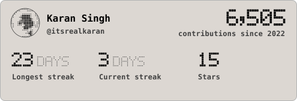

**contributions** · light · regular

`https://github.com/itsrealkaran/contributions?username=itsrealkaran&theme=light&size=regular`

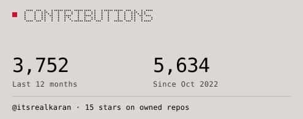

**contributions** · light · wide

`https://github.com/itsrealkaran/contributions?username=itsrealkaran&theme=light&size=wide`

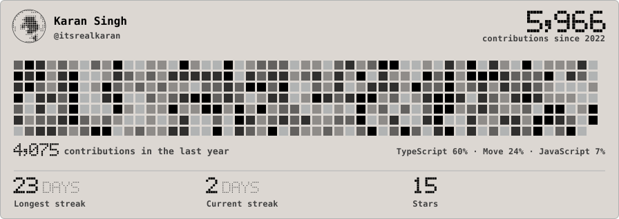

## red

**contributions** · red · mini

`https://github.com/itsrealkaran/contributions?username=itsrealkaran&theme=red&size=mini`

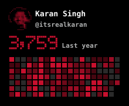

**contributions** · red · compact

`https://github.com/itsrealkaran/contributions?username=itsrealkaran&theme=red&size=compact`

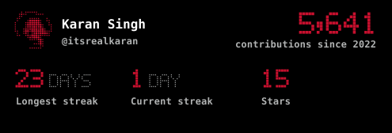

**contributions** · red · regular

`https://github.com/itsrealkaran/contributions?username=itsrealkaran&theme=red&size=regular`

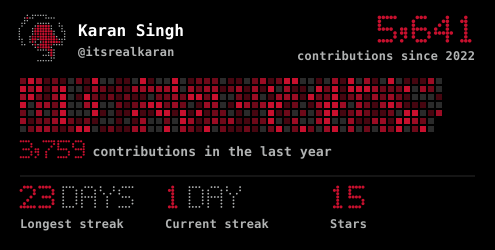

**contributions** · red · wide

`https://github.com/itsrealkaran/contributions?username=itsrealkaran&theme=red&size=wide`

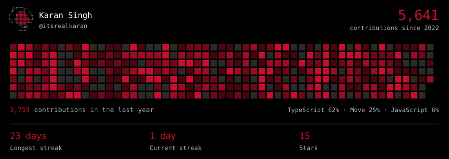

## blue

**contributions** · blue · mini

`https://github.com/itsrealkaran/contributions?username=itsrealkaran&theme=blue&size=mini`

**contributions** · blue · compact

`https://github.com/itsrealkaran/contributions?username=itsrealkaran&theme=blue&size=compact`

**contributions** · blue · regular

`https://github.com/itsrealkaran/contributions?username=itsrealkaran&theme=blue&size=regular`

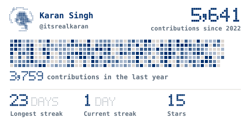

**contributions** · blue · wide

`https://github.com/itsrealkaran/contributions?username=itsrealkaran&theme=blue&size=wide`

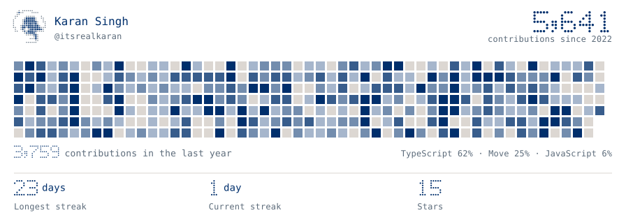

## yellow

**contributions** · yellow · mini

`https://github.com/itsrealkaran/contributions?username=itsrealkaran&theme=yellow&size=mini`

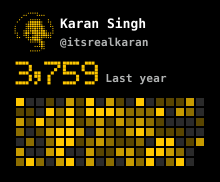

**contributions** · yellow · compact

`https://github.com/itsrealkaran/contributions?username=itsrealkaran&theme=yellow&size=compact`

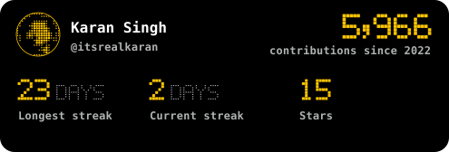

**contributions** · yellow · regular

`https://github.com/itsrealkaran/contributions?username=itsrealkaran&theme=yellow&size=regular`

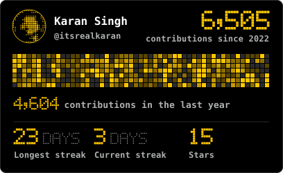

**contributions** · yellow · wide

`https://github.com/itsrealkaran/contributions?username=itsrealkaran&theme=yellow&size=wide`

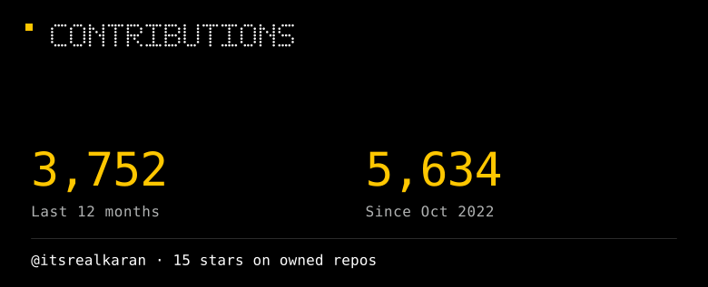

## torvalds

The profile photo is drawn as a glyph beside the name. `glyph=0` leaves the portrait off.

**contributions** · classic · wide

`https://github.com/itsrealkaran/contributions?username=torvalds&theme=classic&size=wide`

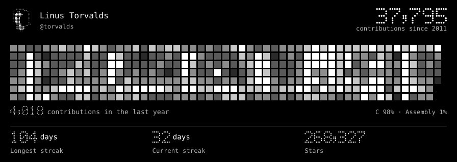
