# Contributions

A year of squares, then the last year, the streaks, and stars.

Wide also names the top public languages. Mini keeps the recent weeks of the same grid. Beside the name, the profile photo is redrawn as dots and cropped to a circle. The face uses the main colour. A thin line sits on the edge of that circle.

An SVG for a GitHub profile. Place the URL in a README, on a site, or anywhere an image is allowed.

## Contents

- [Usage](#usage)
- [Themes](#themes)
- [Sizes](#sizes)
- [Parameters](#parameters)
- [Examples](#examples)
- [Generate files](#generate-files)
- [Run locally](#run-locally)
- [Deploy](#deploy)
- [Configuration](#configuration)
- [Private data](#private-data)
- [Contributing](#contributing)

## Usage

```text
https://<host>/contributions?username=itsrealkaran
```

```md

```

Leave `theme` and `size` off for the classic regular card. An unknown username, theme, or size still returns an SVG, so the image slot in a README stays intact.

## Themes

| Theme | Background | Mark |
| --- | --- | --- |
| `classic` | Pure Black `#000000` | white |
| `classic-r` | Pure Black `#000000` | N-Red `#C8102E` |
| `white` | Pure White `#FFFFFF` | black |
| `white-r` | Pure White `#FFFFFF` | N-Red `#C8102E` |
| `light` | N-Grey `#DCD7D2` | N-Red `#C8102E` |
| `red` | Pure Black `#000000` | N-Red `#C8102E` |
| `blue` | Pure White `#FFFFFF` | N-Blue `#002F6C` |
| `yellow` | Pure Black `#000000` | N-Yellow `#FFC700` |

The numbers are a square dot grid. Day counts use that same grid in the quiet colour. Other labels stay monospace. On red, blue, and yellow the portrait, including its outline, uses that colour. On `classic-r` and `white-r` the counts stay white or black, and the portrait ring is N-Red. The latest day, the rule, and the small corner mark are N-Red.

## Sizes

| Size | Dimensions | Contents |
| --- | --- | --- |
| `mini` | 220×182 | The profile photo, the name, the last year, and the recent weeks. |
| `compact` | 495×168 | The profile photo, the name, the total since the join year, and the three counts. |
| `regular` | 495×250 | The same header, with the year grid. Default. |
| `wide` | 896×318 | The year grid, the three counts, and the top public languages. |

The files in `dist/` use the theme name, then the size: `classic-regular.svg`.

## Parameters

| Parameter | Required | Default | Purpose |
| --- | --- | --- | --- |
| `username` | yes |  | GitHub login. `user` is the same parameter. |
| `theme` | no | `classic` | One of the themes above. |
| `size` | no | `regular` | One of the sizes above. |
| `glyph` | no | on | `0`, `no`, `off`, or `false` hides the profile photo. `pfp` is the same parameter. |

`glyph=0` leaves the profile photo off. `pfp=0` does the same. The corner mark returns when the photo is off.

## Examples

Previews use `itsrealkaran`. Replace `<host>` with your server.

### classic

#### mini

`https://<host>/contributions?username=itsrealkaran&theme=classic&size=mini`

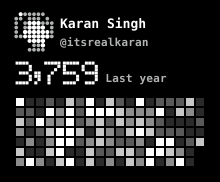

#### compact

`https://<host>/contributions?username=itsrealkaran&theme=classic&size=compact`

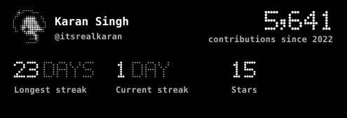

#### regular

This is the default. You can leave `theme` and `size` off and get this card.

`https://<host>/contributions?username=itsrealkaran&theme=classic&size=regular`

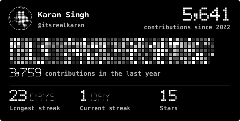

#### wide

`https://<host>/contributions?username=itsrealkaran&theme=classic&size=wide`

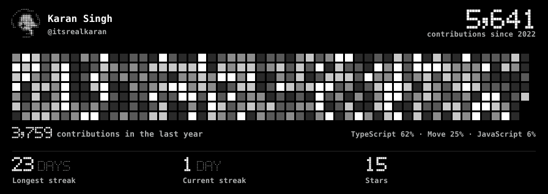

### classic-r

#### mini

`https://<host>/contributions?username=itsrealkaran&theme=classic-r&size=mini`

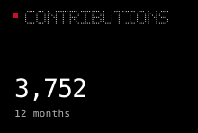

#### compact

`https://<host>/contributions?username=itsrealkaran&theme=classic-r&size=compact`

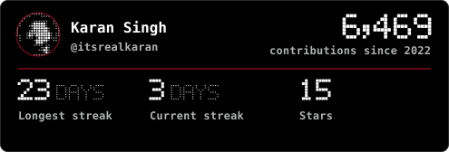

#### regular

`https://<host>/contributions?username=itsrealkaran&theme=classic-r&size=regular`

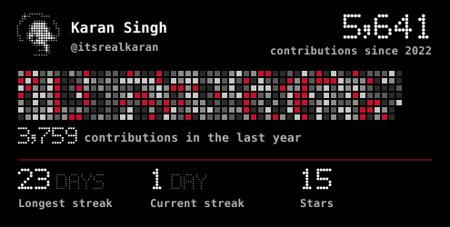

#### wide

`https://<host>/contributions?username=itsrealkaran&theme=classic-r&size=wide`

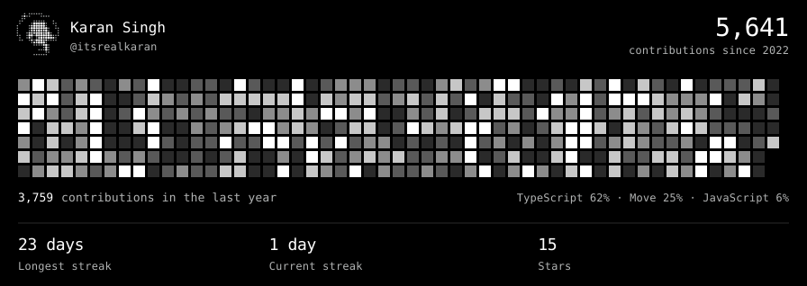

### white

#### mini

`https://<host>/contributions?username=itsrealkaran&theme=white&size=mini`

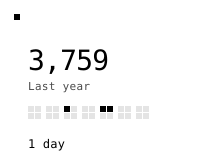

#### compact

`https://<host>/contributions?username=itsrealkaran&theme=white&size=compact`

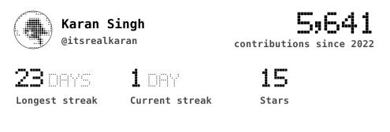

#### regular

`https://<host>/contributions?username=itsrealkaran&theme=white&size=regular`

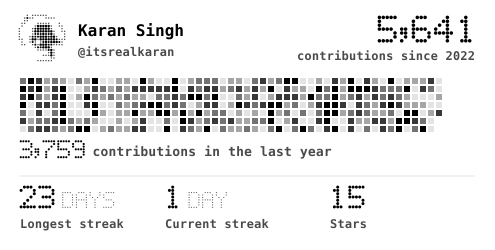

#### wide

`https://<host>/contributions?username=itsrealkaran&theme=white&size=wide`

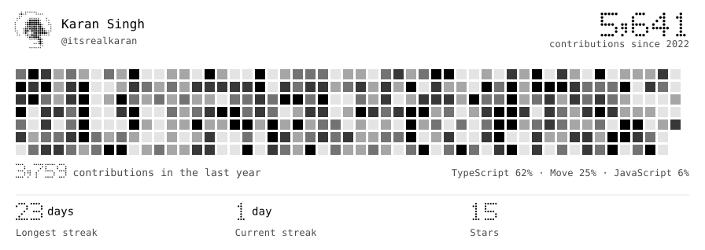

### white-r

#### mini

`https://<host>/contributions?username=itsrealkaran&theme=white-r&size=mini`

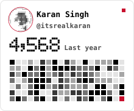

#### compact

`https://<host>/contributions?username=itsrealkaran&theme=white-r&size=compact`

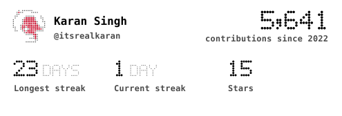

#### regular

`https://<host>/contributions?username=itsrealkaran&theme=white-r&size=regular`

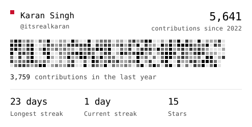

#### wide

`https://<host>/contributions?username=itsrealkaran&theme=white-r&size=wide`

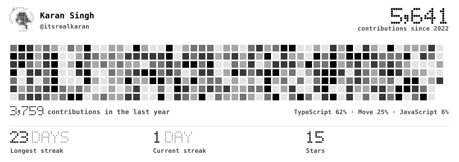

### light

#### mini

`https://<host>/contributions?username=itsrealkaran&theme=light&size=mini`

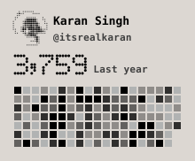

#### compact

`https://<host>/contributions?username=itsrealkaran&theme=light&size=compact`

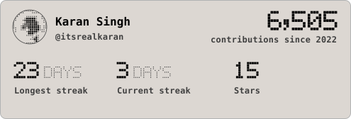

#### regular

`https://<host>/contributions?username=itsrealkaran&theme=light&size=regular`

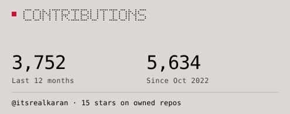

#### wide

`https://<host>/contributions?username=itsrealkaran&theme=light&size=wide`

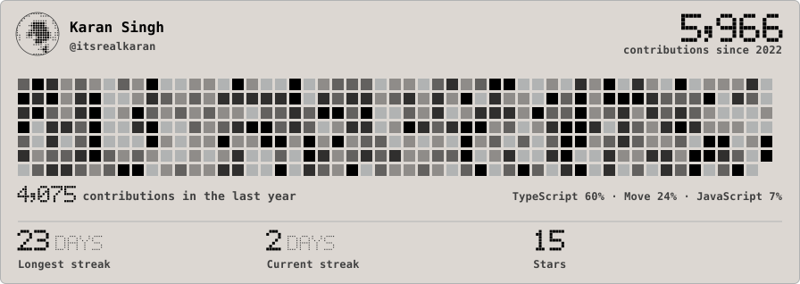

### red

#### mini

`https://<host>/contributions?username=itsrealkaran&theme=red&size=mini`

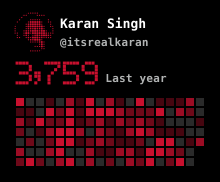

#### compact

`https://<host>/contributions?username=itsrealkaran&theme=red&size=compact`

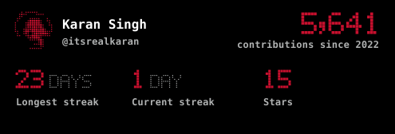

#### regular

`https://<host>/contributions?username=itsrealkaran&theme=red&size=regular`

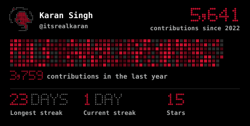

#### wide

`https://<host>/contributions?username=itsrealkaran&theme=red&size=wide`

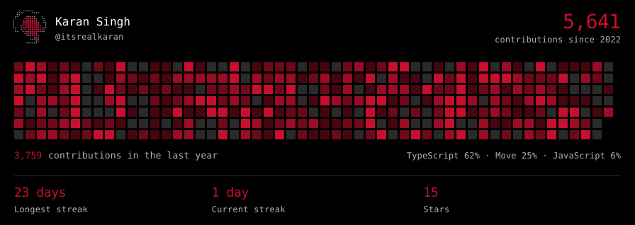

### blue

#### mini

`https://<host>/contributions?username=itsrealkaran&theme=blue&size=mini`


#### compact

`https://<host>/contributions?username=itsrealkaran&theme=blue&size=compact`

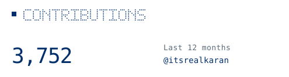

#### regular

`https://<host>/contributions?username=itsrealkaran&theme=blue&size=regular`

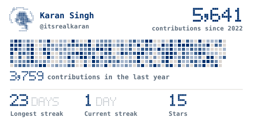

#### wide

`https://<host>/contributions?username=itsrealkaran&theme=blue&size=wide`

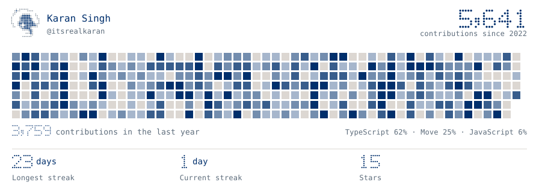

### yellow

#### mini

`https://<host>/contributions?username=itsrealkaran&theme=yellow&size=mini`

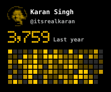

#### compact

`https://<host>/contributions?username=itsrealkaran&theme=yellow&size=compact`

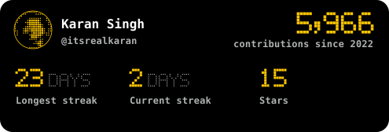

#### regular

`https://<host>/contributions?username=itsrealkaran&theme=yellow&size=regular`

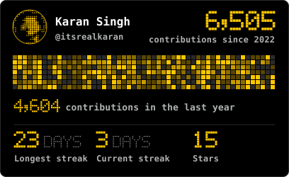

#### wide

`https://<host>/contributions?username=itsrealkaran&theme=yellow&size=wide`

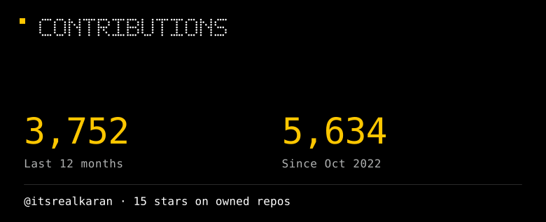

## Generate files

Write the SVG files into the repo when you want a fixed picture instead of a live URL.

```bash
python3 render.py itsrealkaran
```

Python 3 is enough. There is no package to install. Files land in `dist/<login>/`. Public numbers use `gh` when it is signed in on that machine, or `GH_TOKEN` / `GITHUB_TOKEN`.

## Run locally

The container serves the same path and the same query.

### Python container

```bash
docker build -t contributions .
docker run --env GH_TOKEN --env PORT=8080 -p 8080:8080 contributions
```

If the token is in a local `.env` file, pass that file instead:

```bash
docker run --env-file .env --env PORT=8080 -p 8080:8080 contributions
```

The container runs `serve.py`. Open `http://127.0.0.1:8080/contributions?username=itsrealkaran`.

The image does not include the `gh` command. Set `GH_TOKEN` when you start it. Without a token, GitHub allows about 60 requests an hour.


## Deploy

Fork this repo for your own host. Your copy stays awake if a shared deploy sleeps, your traffic stays off a shared GitHub limit, and you can add a token for your own counts.

1. Fork the repo.
2. Deploy the Dockerfile on Fly, Railway, Render, Cloud Run, or a virtual machine.
3. Set the variables below as secrets. Do not commit them.
4. Open `https://<your-host>/contributions?username=yourname`.

Use that host in the image URL. The path and the query stay the same.

## Configuration

| Variable | Required | Purpose |
| --- | --- | --- |
| `GH_TOKEN` | for a public server | GitHub token. `GITHUB_TOKEN` is the same variable. |
| `PORT` | no | Listen port. Default `8080`. |
| `CARD_CACHE_SECONDS` | no | How long a finished SVG is reused. Default `3600`. |

### Create a token

1. On GitHub, open Settings, then Developer settings, then Personal access tokens, then Tokens (classic).
2. Generate a new token.
3. Public cards need no extra scopes. The token raises the server limit from about 60 requests an hour to 5,000.
4. To include your own private counts, add the `repo` scope. The token account must match `username`.
5. Set the value as `GH_TOKEN` on the host. Do not put it in the image URL, this README, or git.

## Private data

A public card needs no token. Contribution counts include private days only when that person has turned private contributions on in their GitHub profile.

To count your own private repository stars as well, set `GH_TOKEN` to a classic personal access token for the same account as `username`. Give that token the `repo` scope. Other usernames stay public. Private repository names are never drawn, and the token is never put in the image URL.

## Contributing

This folder is the card: the drawing, the GitHub fetch, and the server.

1. Fork the repo and edit `render.py`, or the files beside it when the change is the data or the colours.
2. Draw a sample with `python3 render.py yourname` and open `dist/yourname/`.
3. The live routes use that same drawing.
4. Do not commit a token, a `.env` file, or a private repository name.
5. Open a pull request and name the theme and size you checked.
